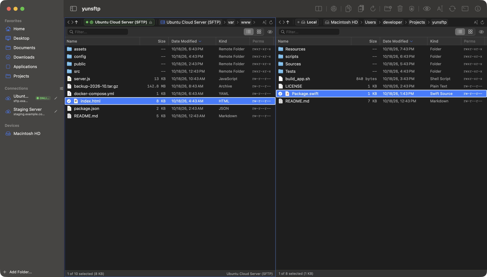

<p align="center">
  
</p>

<h1 align="center">yunsftp</h1>

<p align="center">
  <strong>An ultra-fast, ad-free, native dual-pane SFTP client and file manager built for Apple Silicon macOS.</strong><br>
  Designed from the ground up with Swift 6, SwiftUI, and AppKit for maximum speed and simplicity.
</p>

<p align="center">
  <a href="#-features"></a>
  <a href="#-features"></a>
  <a href="#-features"></a>
  <a href="#-automated-testing"></a>
  <a href="LICENSE"></a>
  
</p>

---

<p align="center">
  
</p>

## 💡 Why yunsftp?

Most file transfer apps today are bloated with paid subscription models, intrusive banner ads, or wrapped inside heavy Chromium/Electron runtimes that consume gigabytes of memory and take seconds to launch. Legacy Intel-only tools (like ForkLift 2) also face obsolescence when macOS discontinues Rosetta 2.

**yunsftp** was created to return to what matters: **blazing fast, lightweight, and clutter-free file management**. Built 100% native in **Swift 6 + SwiftUI & AppKit**, it launches in under 0.2 seconds, uses minimal memory, and gives you total control through classic dual-pane productivity and full macOS Finder keyboard parity.

---

## ⚡️ Feature Comparison

| Feature / Metric | yunsftp | Legacy ForkLift 2 | Commercial Clients | Electron-based Tools |
|:---|:---:|:---:|:---:|:---:|
| **Price / License** | **100% Free (MIT)** | Free (Discontinued) | $20–$40/yr Subscriptions | Ad-supported or freemium |
| **Ads / Tracking** | **Zero (Clean)** | None | Upsell banners | Built-in telemetry / ads |
| **Architecture** | **Native arm64 (M1–M4)** | Intel (Rosetta 2 required) | Universal | Heavy Chromium runtime |
| **Startup Time** | **< 0.2 seconds** | ~1.5 seconds | ~1.2 seconds | 3–5 seconds |
| **Dual-Pane Side-by-Side**| **Yes (Interactive)** | Yes | Single-pane or tabbed | Single-window view |
| **Finder Keyboard Parity**| **Full (`Enter`, `Cmd+Down`, `Space`)**| Partial | Custom keybindings | Browser-style shortcuts |
| **Korean / Unicode Paths**| **Automatic NFC/NFD & C-escape fix**| Prone to errors | Inconsistent | Encoding issues common |
| **System Keychain** | **Apple Security.framework** | Keychain | Custom vaults | Plaintext or app vault |

---

## ✨ Key Features

### 1. 100% Free & Open Source (No Ads, No Subscriptions)
- No tracking scripts, no analytics, no account registration, and no license checks.
- Clean and distraction-free interface focused purely on high-performance file management.

### 2. True Dual-Pane Productivity
- **Adjustable Split Views**: Freely resize left and right panes or press `Tab` to switch focus instantly.
- **Cross-Pane Transfers**:
  - `F5`: One-key copy to opposite pane (Local copy, SFTP upload, or SFTP download).
  - `F6`: One-key move to opposite pane.
- **Drag & Drop**: Drag between panes, drop directly into subfolders, or drag from macOS Finder.
- **Live Transfer Metrics**: Animated top banner showing live progress percentage, transfer speed (`MB/s`), and remaining time.

### 3. Finder Keyboard Parity & Precision Selection
- **`Enter`**: In-place inline rename (original filename pre-filled with a spacious editor).
- **`Cmd + Down` or Double-Click**: Enter folder or open file in default macOS app.
- **`Backspace` or `Cmd + Up`**: Enclosing folder navigation.
- **`Space`**: Toggle selection ON/OFF — move with arrow keys and toggle multiple non-contiguous files.
- **`Shift + Up / Down`**: Continuous range selection with smart contraction when reversing direction.
- **`Cmd + Backspace` / `Ctrl + Backspace`**: Move local files to Trash / safely delete remote SFTP files.
- **`Cmd + Shift + N`**: Create new folder in current pane.
- **`Cmd + K`**: Open Remote Connections Manager.
- **Rubber-band Bounce Snap-Back**: Native horizontal scroll bounce that prevents stuck blank space at table margins.
- **Interactive Headers**: Click anywhere on a table header cell to sort; hover on dividers to resize columns.

### 4. Resilient SFTP & Unicode Parity
- **Full NFC / NFD Normalization**: Bridges macOS decomposed Unicode (NFD) and Linux server precomposed Unicode (NFC), preventing `"No such file or directory"` errors on foreign filenames.
- **Real-Time C-Escape Decoding**: Automatically detects and decodes 8-bit octal (`\353\266\200...`) and 16-bit hex escape sequences into clean human-readable Unicode text.
- **Clean Port Formatting**: Strict numeric port handling without localization commas (`2222` instead of `13,622`).
- **Encrypted Keychain Storage**: Stores passwords securely using Apple's `Security.framework`.
- **Live Socket Diagnostics (`ConnectionTestService`)**: One-click TCP socket handshake, SSH banner inspection, and millisecond latency test.

### 5. Automatic Migration from Legacy ForkLift 2
- Automatically detects and migrates existing bookmarks, SSH keys (`~/.ssh/id_ed25519`), custom ports, and favorite locations from `com.binarynights.ForkLift2.plist`.

---

## ⌨️ Keyboard Shortcuts Reference

| Shortcut | Action | Description |
|:---|:---|:---|
| `Space` | **Toggle Selection** | Select / deselect individual files while browsing |
| `Enter` | **Rename** | In-place rename with current filename pre-filled |
| `Cmd + Down` / Double-Click | **Open / Enter** | Enter folder or open file in default viewer |
| `Backspace` / `Cmd + Up` | **Parent Folder** | Navigate up one directory level |
| `Up` / `Down` | **Cursor Move** | Browse file and folder list |
| `Shift + Up / Down` | **Range Selection** | Multi-item selection with natural contraction |
| `Tab` | **Switch Pane** | Toggle active focus between Left and Right panes |
| `Cmd + K` | **Connections** | Open Remote Connections Manager |
| `F5` | **Copy** | Copy selected items to opposite pane (Upload/Download) |
| `F6` | **Move** | Move selected items to opposite pane |
| `Cmd + Shift + N` | **New Folder** | Create new folder in active directory |
| `Cmd + Backspace` | **Delete** | Move local items to Trash / delete remote files |
| `Ctrl + Backspace` | **SFTP Delete** | Alternative remote file removal |
| `Cmd + D` | **Duplicate** | Create duplicate copy of selected item |
| `Cmd + Shift + .` | **Hidden Files** | Toggle visibility of hidden dotfiles |
| `Home` / `End` | **Jump Top / Bottom** | Jump to first or last item in current pane |
| `Esc` | **Close** | Dismiss sheets, search bars, or previews |

> 📖 For detailed instructions and workflows, see the complete [User Guide](docs/USER_GUIDE.md).

---

## 🚀 Installation

### Option 1: Download Pre-built Release (Recommended)
Download the latest `yunsftp.app` or `.zip` from the [Releases](https://github.com/dohyun-yun/yunsftp/releases) page, unzip, and move it to your `/Applications` folder.

### Option 2: Build from Source
Ensure Swift 6 and Xcode command-line tools are installed:

```bash
# 1. Clone the repository
git clone https://github.com/dohyun-yun/yunsftp.git
cd yunsftp

# 2. Build release binary and install to /Applications
./scripts/build_app.sh
./scripts/install.sh

# 3. Launch yunsftp
open /Applications/yunsftp.app
```

> [!NOTE]
> **Full Disk Access Setup**  
> To browse system directories, external drives, and network shares without repeated permission prompts, grant Full Disk Access once:
> 1. Open macOS **System Settings** > **Privacy & Security**
> 2. Select **Full Disk Access**
> 3. Toggle **yunsftp** to **ON** *(or add `/Applications/yunsftp.app`)*

---

## 🧪 Automated Testing

`yunsftp` includes 42 automated unit and integration tests verifying SFTP parity, Unicode normalization, and UI interactions:

```bash
swift test
```

```text
Test Suite 'All tests' passed at 2026-10-18.
Executed 42 tests, with 0 failures (0 unexpected) in 0.846 seconds.
```

- **Parity Verification**: File copy, move, delete, directory creation, and in-place rename across local and SFTP environments.
- **Escape & Unicode Engines**: NFC normalization, octal (`\353...`) and hex string restoration.
- **UX & Interaction Integrity**: `Space` selection toggling, `Shift+Arrow` contraction, and comma-free port inputs.

---

## 📄 License

This project is licensed under the [MIT License](LICENSE).
Enjoy a clean, fast, and ad-free file management experience on macOS!
