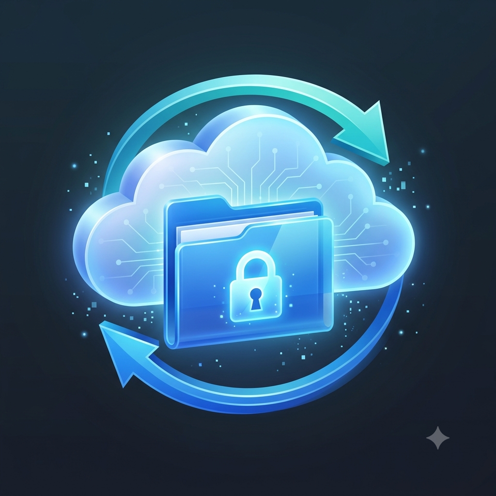
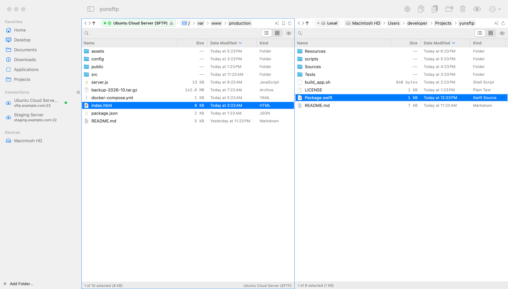

<p align="center">
  
</p>

<h1 align="center">yunsftp</h1>

<p align="center">
  <strong>A fast, native dual-pane SFTP client and file manager for Apple Silicon Macs.</strong><br>
  Free and open source. No ads, no accounts, no telemetry.
</p>

<p align="center">
  <a href="https://github.com/dohyun-yun/yunsftp/releases/latest"></a>
  <a href="https://github.com/dohyun-yun/yunsftp/actions/workflows/ci.yml"></a>
  <a href="https://github.com/dohyun-yun/yunsftp/releases"></a>
  <a href="LICENSE"></a>
</p>

<p align="center">
  English · <a href="README.ko.md">한국어</a>
</p>

<p align="center">
  <picture>
    <source media="(prefers-color-scheme: dark)" srcset="docs/assets/screenshot-dark.png">
    
  </picture>
</p>

<p align="center">
  <a href="https://github.com/dohyun-yun/yunsftp/releases/latest"><strong>Download for macOS</strong></a> · macOS 13 or later · Apple Silicon
</p>

## Why yunsftp

- **Two panes, one keystroke.** Local on one side, server on the other. `F5` copies, `F6` moves, drag and drop works in both directions and into subfolders.
- **Feels like Finder.** The same keys do the same things: `Return` renames, `⌘↓` opens, `Space` toggles selection, `⌘⇧G` goes to a folder, `⌘Z` undoes.
- **Honest about your files.** Korean and other non-ASCII names round-trip correctly between macOS (NFD) and Linux servers (NFC), name conflicts ask before anything is replaced, and remote deletes ask first.
- **Nothing to configure, nothing phoning home.** Your passwords live in the macOS Keychain, host keys are verified against `~/.ssh/known_hosts`, and the only network request the app makes on its own is an optional once-a-day check of GitHub Releases.

## Install in 30 seconds

**Homebrew**

```bash
brew tap dohyun-yun/yunsftp
brew trust dohyun-yun/yunsftp          # newer Homebrew asks once before loading a third-party tap
brew install --cask yunsftp            # add --no-quarantine to skip the first-launch Gatekeeper step
```

Upgrade later with `brew upgrade --cask yunsftp`.

**Manual download**

1. **Download** the `.dmg` from the [latest release](https://github.com/dohyun-yun/yunsftp/releases/latest) and drag `yunsftp.app` to `/Applications`.
2. **First launch:** releases are ad-hoc signed (not notarized), so macOS blocks the first open. Right-click `yunsftp.app` → **Open** → **Open** once, or run:
   ```bash
   xattr -d com.apple.quarantine /Applications/yunsftp.app
   ```
   Compare the download with `checksums.txt` on the release page if you want to be sure.
3. **Optional:** grant **Full Disk Access** (System Settings → Privacy & Security) once, so external drives and protected folders open without prompts.

Prefer building it yourself? See [Build from source](#build-from-source).

## Connect to your first server

1. Press **⌘K** (or click **Connect** in the toolbar) and add a host, user and password or key. Passwords can be saved to the Keychain.
2. Already have servers in `~/.ssh/config`? The first-run banner and **Import…** in the connection manager pull them in, together with Cyberduck and ForkLift 2 bookmarks.
3. Click a connection in the sidebar. Bookmark folders you come back to with the ★ in the path bar; recent folders are in the connection's context menu.

## What you get

| | |
|:--|:--|
| **🗂 Dual-pane transfers**<br>Copy/move between any two locations: local↔local, local↔server, server↔server. Keep-both, replace or skip on conflicts, with "apply to all". | **📋 Transfers window** (`⌘⇧T`)<br>Queue, per-item cancel that really stops the transfer, retry for failures, and history. |
| **✏️ Edit on the server**<br>Open a remote file in your editor; every save uploads automatically until you stop the session. | **🔎 Find on server** (`⌘⇧F`)<br>Recursive name search below the current remote folder, double-click to reveal. |
| **⌨️ Finder keyboard parity**<br>`Return`, `⌘↓`, `Space`, `⇧↑/↓` range selection, `⌘⇧N`, `⌘⌫`, `⌘F` filter, `⌘⇧G` go to folder, `⌘Z` undo. | **🧰 File tools**<br>Quick Look, Get Info with folder sizes, chmod, multi-rename, compare & sync, zip/unzip, open in Terminal or iTerm. |
| **🌏 Unicode done right**<br>NFC/NFD normalization and decoding of `ls` escape sequences, so `한글 파일.txt` is `한글 파일.txt` everywhere. UI in English and Korean. | **⚙️ Settings** (`⌘,`)<br>Relative dates, visible columns, font size, delete confirmation, terminal app, update check. Toolbar is customizable. |
| **🗂 Tabs** (`⌘T`)<br>Several folders or servers per pane; `⌘⇧[` / `⌘⇧]` switch, `⌘W` closes. | **📤 Drag to Finder**<br>Drag a remote file onto the Desktop, Mail or any app: it downloads on drop. |

## Security and privacy

- Transfers run over the system OpenSSH (`sftp`, `ssh`, `scp`). Sessions are multiplexed, so one login serves many operations.
- Host keys are checked against `~/.ssh/known_hosts` (trust on first use). A changed key stops the connection with an explanation.
- Algorithms are OpenSSH defaults. A per-connection **Allow legacy SSH algorithms** switch exists for old devices and is off by default.
- Passwords are stored in the macOS Keychain and handed to OpenSSH through a one-shot helper created with mode `0700`.
- Remote deletes are confirmed and run inside the SFTP subsystem; the app never executes `rm` on your server.
- Passphrase-protected keys must be loaded into `ssh-agent` first: `ssh-add --apple-use-keychain ~/.ssh/id_ed25519`.
- Found something? See [SECURITY.md](SECURITY.md).

<details>
<summary><strong>Keyboard shortcuts</strong></summary>

| Shortcut | Action |
|:--|:--|
| `Tab` | Switch active pane |
| `Return` | Rename |
| `⌘↓` / double-click | Open folder or file |
| `⌫` / `⌘↑` | Enclosing folder |
| `Space` | Toggle selection of the focused item |
| `⇧↑` / `⇧↓` | Extend or shrink the selection |
| `⌘A` | Select all |
| `F5` / `F6` | Copy / move to the other pane |
| `⌘C` / `⌘X` / `⌘V` | Copy / cut / paste (also from Finder) |
| `⌘⌫` | Move to Trash (local) / delete (server, asks first) |
| `⌘D` | Duplicate |
| `⌘⇧N` | New folder |
| `⌘F` | Filter the current folder |
| `⌘⇧F` | Find on server |
| `⌘⇧G` | Go to folder |
| `⌘Y` | Quick Look |
| `⌘I` | Get Info |
| `⌘K` | Connections |
| `⌘⇧T` | Transfers window |
| `⌘⇧.` | Show hidden files |
| `⌘Z` | Undo rename, move or trash (local) |
| `Esc` | Close filter, deselect, dismiss sheets |

</details>

## FAQ

**Korean (or other non-ASCII) file names show up garbled or "not found".**  
yunsftp normalizes names to NFC and decodes `ls` escapes before using them, so this should not happen. If it does, open an issue with the server type and an example name.

**My Synology shows `/` instead of `/volume1`.**  
SFTP on DSM is chrooted to the shares you enabled. Use the folder shown by the server as root; bookmarks work from there.

**Connection fails with "no matching key exchange method".**  
The device only offers SHA-1 algorithms. Edit the connection and enable **Allow legacy SSH algorithms** for that server only.

**Does the app send anything anywhere?**  
Only to your servers. The optional update check requests `api.github.com/repos/dohyun-yun/yunsftp/releases/latest` once a day and can be turned off in Settings.

## Roadmap

Progress is tracked in [docs/IMPROVEMENT_PLAN.md](docs/IMPROVEMENT_PLAN.md). Next up: a native SFTP engine for true byte-level progress and resume, and a SwiftUI `Table`-based file list. Notarized builds are not planned for now; the Homebrew cask and the first-launch note above cover installation.

## Build from source

Requirements: Apple Silicon Mac, Xcode 16 or later (Swift 6 toolchain). The app itself runs on macOS 13+.

```bash
git clone https://github.com/dohyun-yun/yunsftp.git
cd yunsftp
swift test                 # unit + integration tests (uses the local sftp-server)
./scripts/build_app.sh     # build/yunsftp.app, ad-hoc signed
./scripts/install.sh       # copy to /Applications
```

`scripts/package_release.sh` produces the dmg/zip/checksums; the same script runs in CI when a `v*` tag is pushed.

## Contributing

Bug reports and pull requests are welcome. Please read [CONTRIBUTING.md](CONTRIBUTING.md) first; the short version is one topic per PR, tests for behaviour changes, and no environment-specific values in the code.

## License

[MIT](LICENSE).
